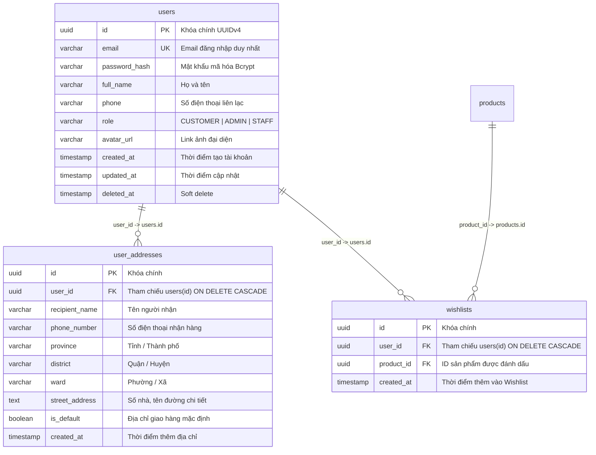
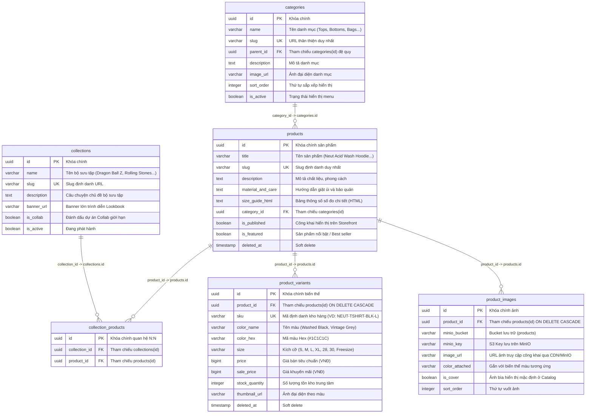
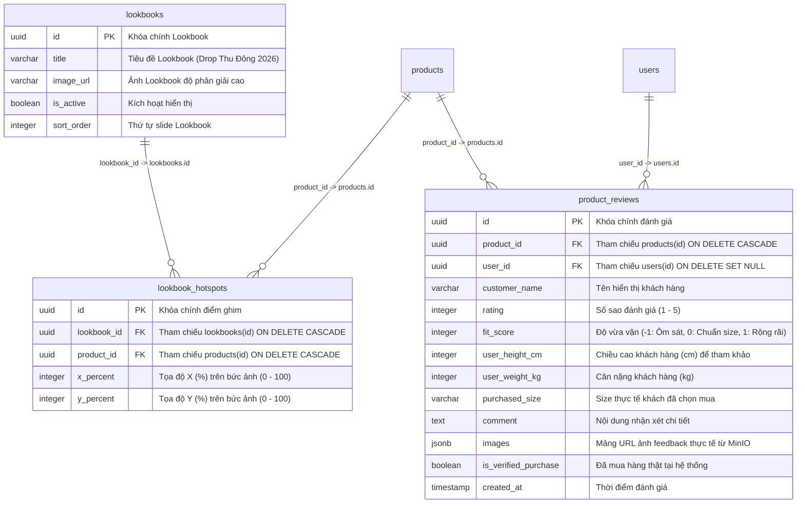
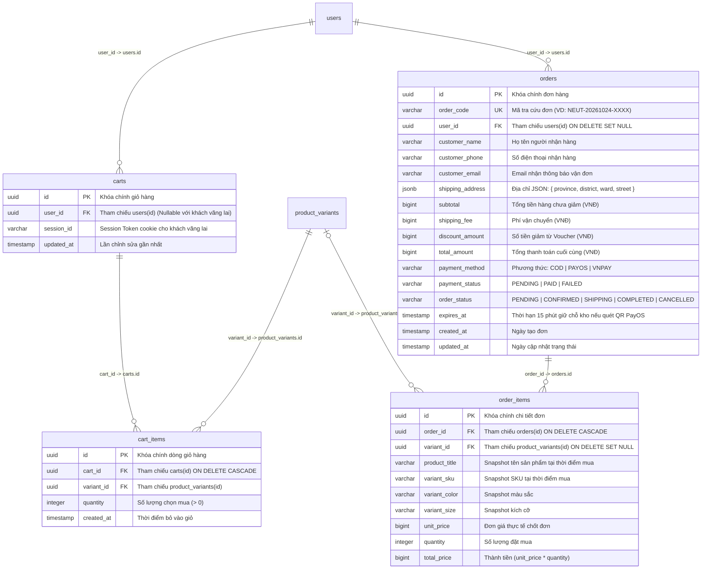
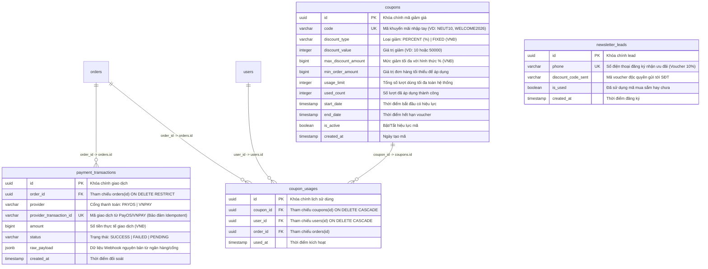
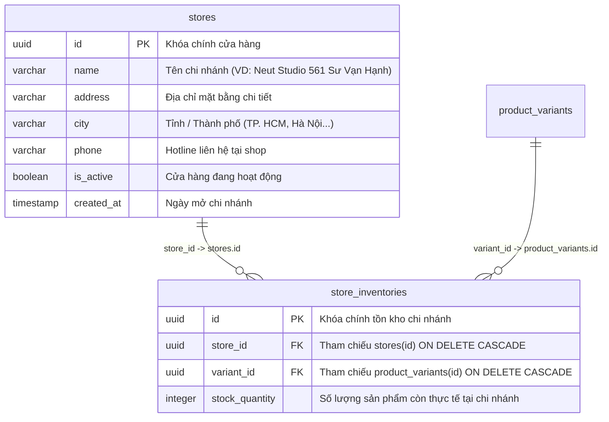

# Sơ Đồ Thực Thể Quan Hệ (ERD) Hệ Thống Neut-Studio

> **Tài liệu đặc tả Cơ sở dữ liệu và Sơ đồ quan hệ thực thể (Entity-Relationship Diagram - ERD)**  
> Dự án: **Neut-Studio Streetwear E-Commerce Monorepo**  
> Hệ quản trị CSDL: **PostgreSQL 16** | ORM: **Drizzle ORM** | Định danh khóa chính: **UUID (v4)**

---

## 1. Sơ Đồ ERD Tổng Quan (Master ERD)

> **File ảnh sơ đồ độ phân giải cực cao (Ultra HD - 5030x1600px)**: [docs/images/01_master_erd.png](file:///c:/Project/Neut-Studio/docs/images/01_master_erd.png)  
> **File đồ họa Vector không vỡ hình**: [docs/images/01_master_erd.svg](file:///c:/Project/Neut-Studio/docs/images/01_master_erd.svg)

Biểu đồ dưới đây mô tả toàn bộ 22 bảng thực thể với đầy đủ các trường Khóa chính (`PK`), Khóa ngoại (`FK`) và thể hiện rõ ràng các trường liên kết cụ thể giữa các bảng:

```mermaid
erDiagram
    direction TB

    %% --- 1. NGƯỜI DÙNG & TÀI KHOẢN (Auth & Users) ---
    users ||--o{ user_addresses : "user_id -> users.id"
    users ||--o{ wishlists : "user_id -> users.id"
    users ||--o{ carts : "user_id -> users.id"
    users ||--o{ orders : "user_id -> users.id"
    users ||--o{ product_reviews : "user_id -> users.id"
    users ||--o{ coupon_usages : "user_id -> users.id"

    %% --- 2. DANH MỤC, BỘ SƯU TẬP & SẢN PHẨM (Catalog & Products) ---
    categories ||--o{ products : "category_id -> categories.id"
    collections ||--o{ collection_products : "collection_id -> collections.id"
    products ||--o{ collection_products : "product_id -> products.id"
    products ||--o{ product_variants : "product_id -> products.id"
    products ||--o{ product_images : "product_id -> products.id"
    products ||--o{ wishlists : "product_id -> products.id"
    products ||--o{ product_reviews : "product_id -> products.id"
    products ||--o{ lookbook_hotspots : "product_id -> products.id"
    lookbooks ||--o{ lookbook_hotspots : "lookbook_id -> lookbooks.id"

    %% --- 3. GIỎ HÀNG & KHO CHI NHÁNH (Cart & O2O Inventory) ---
    carts ||--o{ cart_items : "cart_id -> carts.id"
    product_variants ||--o{ cart_items : "variant_id -> product_variants.id"
    stores ||--o{ store_inventories : "store_id -> stores.id"
    product_variants ||--o{ store_inventories : "variant_id -> product_variants.id"

    %% --- 4. ĐƠN HÀNG, THANH TOÁN & KHUYẾN MÃI (Orders, Payments & Coupons) ---
    orders ||--o{ order_items : "order_id -> orders.id"
    product_variants ||--o{ order_items : "variant_id -> product_variants.id"
    orders ||--o{ payment_transactions : "order_id -> orders.id"
    orders ||--o{ coupon_usages : "order_id -> orders.id"
    coupons ||--o{ coupon_usages : "coupon_id -> coupons.id"

    %% ===================================================
    %% ENTITY DEFINITIONS & ATTRIBUTES
    %% ===================================================
    users {
        uuid id PK
        varchar email UK
        varchar password_hash
        varchar full_name
        varchar phone
        varchar role "CUSTOMER | ADMIN | STAFF"
        varchar avatar_url
        timestamp created_at
        timestamp updated_at
        timestamp deleted_at
    }

    user_addresses {
        uuid id PK
        uuid user_id FK
        varchar recipient_name
        varchar phone_number
        varchar province
        varchar district
        varchar ward
        text street_address
        boolean is_default
        timestamp created_at
    }

    wishlists {
        uuid id PK
        uuid user_id FK
        uuid product_id FK
        timestamp created_at
    }

    categories {
        uuid id PK
        varchar name
        varchar slug UK
        uuid parent_id FK
        text description
        varchar image_url
        integer sort_order
        boolean is_active
        timestamp created_at
        timestamp updated_at
    }

    collections {
        uuid id PK
        varchar name
        varchar slug UK
        text description
        varchar banner_url
        boolean is_collab
        boolean is_active
        timestamp created_at
    }

    collection_products {
        uuid id PK
        uuid collection_id FK
        uuid product_id FK
    }

    products {
        uuid id PK
        varchar title
        varchar slug UK
        text description
        text material_and_care
        text size_guide_html
        uuid category_id FK
        boolean is_published
        boolean is_featured
        timestamp deleted_at
        timestamp created_at
        timestamp updated_at
    }

    product_variants {
        uuid id PK
        uuid product_id FK
        varchar sku UK
        varchar color_name
        varchar color_hex
        varchar size
        bigint price
        bigint sale_price
        integer stock_quantity
        varchar thumbnail_url
        timestamp deleted_at
        timestamp created_at
    }

    product_images {
        uuid id PK
        uuid product_id FK
        varchar minio_bucket
        varchar minio_key
        varchar image_url
        varchar color_attached
        boolean is_cover
        integer sort_order
        timestamp created_at
    }

    product_reviews {
        uuid id PK
        uuid product_id FK
        uuid user_id FK
        varchar customer_name
        integer rating
        integer fit_score
        integer user_height_cm
        integer user_weight_kg
        varchar purchased_size
        text comment
        jsonb images
        boolean is_verified_purchase
        timestamp created_at
    }

    lookbooks {
        uuid id PK
        varchar title
        varchar image_url
        boolean is_active
        integer sort_order
        timestamp created_at
    }

    lookbook_hotspots {
        uuid id PK
        uuid lookbook_id FK
        uuid product_id FK
        integer x_percent
        integer y_percent
    }

    carts {
        uuid id PK
        uuid user_id FK
        varchar session_id
        timestamp updated_at
    }

    cart_items {
        uuid id PK
        uuid cart_id FK
        uuid variant_id FK
        integer quantity
        timestamp created_at
    }

    orders {
        uuid id PK
        varchar order_code UK
        uuid user_id FK
        varchar customer_name
        varchar customer_phone
        varchar customer_email
        jsonb shipping_address
        bigint subtotal
        bigint shipping_fee
        bigint discount_amount
        bigint total_amount
        varchar payment_method
        varchar payment_status
        varchar order_status
        timestamp expires_at
        timestamp created_at
        timestamp updated_at
    }

    order_items {
        uuid id PK
        uuid order_id FK
        uuid variant_id FK
        varchar product_title
        varchar variant_sku
        varchar variant_color
        varchar variant_size
        bigint unit_price
        integer quantity
        bigint total_price
    }

    payment_transactions {
        uuid id PK
        uuid order_id FK
        varchar provider
        varchar provider_transaction_id UK
        bigint amount
        varchar status
        jsonb raw_payload
        timestamp created_at
    }

    coupons {
        uuid id PK
        varchar code UK
        varchar discount_type
        integer discount_value
        bigint max_discount_amount
        bigint min_order_amount
        integer usage_limit
        integer used_count
        timestamp start_date
        timestamp end_date
        boolean is_active
        timestamp created_at
    }

    coupon_usages {
        uuid id PK
        uuid coupon_id FK
        uuid user_id FK
        uuid order_id FK
        timestamp used_at
    }

    stores {
        uuid id PK
        varchar name
        address varchar
        city varchar
        phone varchar
        boolean is_active
        timestamp created_at
    }

    store_inventories {
        uuid id PK
        uuid store_id FK
        uuid variant_id FK
        integer stock_quantity
    }

    newsletter_leads {
        uuid id PK
        varchar phone UK
        varchar discount_code_sent
        boolean is_used
        timestamp created_at
    }
```

---

## 2. Phân Rã ERD Theo Từng Nhóm Chức Năng (Domain Modules)

### 2.1. Phân Hệ Người Dùng & Quản Lý Tài Khoản (Authentication & Identity)

Chịu trách nhiệm xác thực người dùng (JWT), phân quyền (Customer / Staff / Admin), quản lý sổ địa chỉ giao hàng và danh sách sản phẩm yêu thích (Wishlist).

* **Quy tắc nghiệp vụ**:
  - `users.role` hỗ trợ RBAC (`CUSTOMER`, `STAFF`, `ADMIN`).
  - Mỗi người dùng chỉ có tối đa 1 địa chỉ `is_default = true`.
  - Cặp `(user_id, product_id)` trong `wishlists` có Unique Index chống trùng lặp.

---

### 2.2. Phân Hệ Danh Mục, Bộ Sưu Tập & Sản Phẩm (Catalog & Products)

Chịu trách nhiệm quản lý cấu trúc phân cấp danh mục, các chiến dịch Collab / Bộ sưu tập thời trang, chi tiết sản phẩm thời trang đường phố và các biến thể kích cỡ / màu sắc / tồn kho.

* **Quy tắc nghiệp vụ**:
  - `product_variants` có ràng buộc kiểm tra toàn vẹn: `price >= 0`, `stock_quantity >= 0`, `sale_price <= price`.
  - Cặp `(product_id, color_name, size)` có Unique Index đảm bảo một sản phẩm không có 2 SKU trùng cỡ và màu.

---

### 2.3. Phân Hệ Trải Nghiệm Mua Sắm & Social Proof (Lookbook, Fit Finder & Reviews)

Chức năng đặc thù cho thương hiệu Streetwear cao cấp: Mua hàng trực quan qua Lookbook Hotspot, đánh giá thực tế form dáng từ người mua và gợi ý size thông minh.

* **Quy tắc nghiệp vụ**:
  - Hotspot tính toán tọa độ theo tỉ lệ % giúp giao diện Responsive co giãn trên mobile/desktop chính xác.
  - `product_reviews.fit_score` phục vụ trực tiếp cho thuật toán **Smart Fit Finder** đưa ra gợi ý size cho người mua tiếp theo.

---

### 2.4. Phân Hệ Giỏ Hàng & Quản Lý Đơn Hàng (Cart, Orders & Fulfillment)

Quản lý luồng mua sắm từ giỏ hàng tạm (cho cả Guest và Thành viên), tạo đơn hàng với khả năng trừ kho nguyên tử (Atomicity), snapshot dữ liệu sản phẩm tại thời điểm mua để chống sai lệch lịch sử kế toán.

* **Quy tắc nghiệp vụ**:
  - `order_items` lưu trữ đầy đủ `product_title`, `variant_sku`, `variant_color`, `variant_size`, `unit_price` dạng Snapshot. Nếu sau này sản phẩm gốc bị xóa hoặc đổi giá thì hóa đơn tài chính của khách vẫn giữ nguyên giá trị pháp lý.
  - `orders.expires_at`: Khi chọn thanh toán trực tuyến qua cổng PayOS/VNPay, hệ thống giữ đơn 15 phút. Quá hạn không thanh toán, giao dịch tự động hoàn kho.

---

### 2.5. Phân Hệ Thanh Toán, Khuyến Mãi & Tiếp Thị (Payments & Marketing)

Tích hợp cổng thanh toán trực tuyến bảo mật chống trùng giao dịch (Idempotency), cơ chế voucher giảm giá đa dạng và thu thập Leads khách hàng thân thiết.

* **Quy tắc nghiệp vụ**:
  - `payment_transactions.provider_transaction_id` là khóa UNIQUE nhằm chống tấn công Replay Attack và xử lý Idempotent khi Webhook gọi nhiều lần.
  - `coupons` có ràng buộc kiểm tra tự động: `end_date > start_date` và `used_count <= usage_limit`.

---

### 2.6. Phân Hệ Chuỗi Cửa Hàng & Tồn Kho Chi Nhánh (Stores & O2O Multi-Location)

Hỗ trợ mô hình O2O (Online to Offline): Khách hàng duyệt web có thể tra cứu ngay cửa hàng gần nhất còn hàng đúng mẫu / đúng size để ghé thử trực tiếp.

* **Quy tắc nghiệp vụ**:
  - Cặp `(store_id, variant_id)` có Unique Index đảm bảo mỗi SKU chỉ có một bản ghi số lượng tồn kho duy nhất tại một chi nhánh.
  - Cho phép người dùng Storefront kiểm tra tức thời tính khả dụng (In-store Availability) mà không cần gọi điện hỏi shop.

---

## 3. Bảng Tổng Hợp Khóa Ngoại & Hành Vi Ràng Buộc (Foreign Keys & Cascade Rules)

| Bảng Nguồn (Child Table) | Cột Khóa Ngoại | Bảng Đích (Parent Table) | Hành vi Khi Xóa (ON DELETE) | Mục Đích Nghiệp Vụ |
| :--- | :--- | :--- | :--- | :--- |
| `user_addresses` | `user_id` | `users(id)` | **CASCADE** | Xóa tài khoản sẽ tự động giải phóng sổ địa chỉ cá nhân |
| `wishlists` | `user_id` | `users(id)` | **CASCADE** | Giải phóng danh sách bookmark khi xóa tài khoản |
| `categories` | `parent_id` | `categories(id)` | **SET NULL** | Xóa danh mục cha thì các danh mục con chuyển lên cấp gốc |
| `products` | `category_id` | `categories(id)` | **SET NULL** | Xóa danh mục không làm mất dữ liệu sản phẩm |
| `collection_products` | `collection_id` | `collections(id)` | **CASCADE** | Xóa chiến dịch Collab sẽ xóa các liên kết sản phẩm thuộc chiến dịch |
| `product_variants` | `product_id` | `products(id)` | **CASCADE** | Xóa sản phẩm gốc sẽ xóa toàn bộ các biến thể kích cỡ/màu |
| `product_images` | `product_id` | `products(id)` | **CASCADE** | Xóa sản phẩm sẽ dọn dẹp các đường dẫn ảnh tương ứng |
| `lookbook_hotspots` | `lookbook_id` | `lookbooks(id)` | **CASCADE** | Xóa ảnh Lookbook sẽ xóa các điểm ghim tọa độ |
| `lookbook_hotspots` | `product_id` | `products(id)` | **CASCADE** | Xóa sản phẩm sẽ xóa điểm ghim trên Lookbook |
| `product_reviews` | `product_id` | `products(id)` | **CASCADE** | Xóa sản phẩm sẽ xóa toàn bộ đánh giá liên quan |
| `product_reviews` | `user_id` | `users(id)` | **SET NULL** | Người dùng xóa tài khoản thì đánh giá vẫn được giữ lại làm Social Proof |
| `cart_items` | `cart_id` | `carts(id)` | **CASCADE** | Xóa giỏ hàng sẽ xóa toàn bộ dòng hàng bên trong |
| `cart_items` | `variant_id` | `product_variants(id)` | **CASCADE** | Biến thể bị xóa sẽ tự động gỡ khỏi giỏ hàng người mua |
| `orders` | `user_id` | `users(id)` | **SET NULL** | Bảo toàn lịch sử đơn hàng và doanh thu khi tài khoản bị xóa |
| `order_items` | `order_id` | `orders(id)` | **CASCADE** | Xóa đơn hàng sẽ giải phóng các dòng sản phẩm chi tiết của đơn |
| `order_items` | `variant_id` | `product_variants(id)` | **SET NULL** | Biến thể bị xóa trong tương lai không làm mất dấu vết hóa đơn lịch sử |
| `payment_transactions` | `order_id` | `orders(id)` | **RESTRICT** | Nghiêm cấm xóa đơn hàng khi đã phát sinh bản ghi giao dịch thanh toán |
| `coupon_usages` | `coupon_id` | `coupons(id)` | **CASCADE** | Dọn dẹp nhật ký khi xóa mã giảm giá |
| `store_inventories` | `store_id` | `stores(id)` | **CASCADE** | Đóng chi nhánh sẽ tự động xóa bản ghi kiểm kê kho của chi nhánh đó |
| `store_inventories` | `variant_id` | `product_variants(id)` | **CASCADE** | Xóa biến thể sẽ tự động cập nhật kho tất cả chi nhánh |

---

## 4. Danh Mục Chỉ Mục Tối Ưu Hiệu Năng (Indexes & Performance Optimization)

1. **Unique Indexes (Đảm bảo tính toàn vẹn dữ liệu)**:
   - `users(email)`: Định danh duy nhất khi đăng nhập.
   - `categories(slug)`: Định danh URL danh mục.
   - `collections(slug)`: Định danh URL bộ sưu tập.
   - `products(slug)`: Định danh URL trang chi tiết sản phẩm.
   - `product_variants(sku)`: Mã vạch kiểm kê kho duy nhất toàn hệ thống.
   - `product_variants(product_id, color_name, size)`: Ngăn chặn một sản phẩm tạo trùng lặp biến thể màu & size.
   - `collection_products(collection_id, product_id)`: Ngăn sản phẩm được gắn trùng lặp vào một bộ sưu tập.
   - `wishlists(user_id, product_id)`: Ngăn người dùng bookmark một sản phẩm 2 lần.
   - `orders(order_code)`: Mã tra cứu đơn hàng công khai duy nhất.
   - `payment_transactions(provider_transaction_id)`: Khóa Idempotency xử lý an toàn cho Webhook thanh toán.
   - `coupons(code)`: Mã voucher nhập vào duy nhất.
   - `store_inventories(store_id, variant_id)`: Đảm bảo tính nhất quán 1 dòng tồn kho cho mỗi SKU tại một shop.
   - `newsletter_leads(phone)`: Chống spam 1 số điện thoại nhận mã giảm giá nhiều lần.

2. **Foreign Key Indexes (Tối ưu truy vấn JOIN)**:
   - Tất cả các trường `*_id` làm khóa ngoại đều được đánh chỉ mục B-Tree để đảm bảo tốc độ cao khi thực hiện các phép `JOIN` phức tạp giữa đơn hàng, biến thể và sản phẩm.
